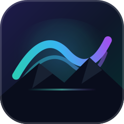
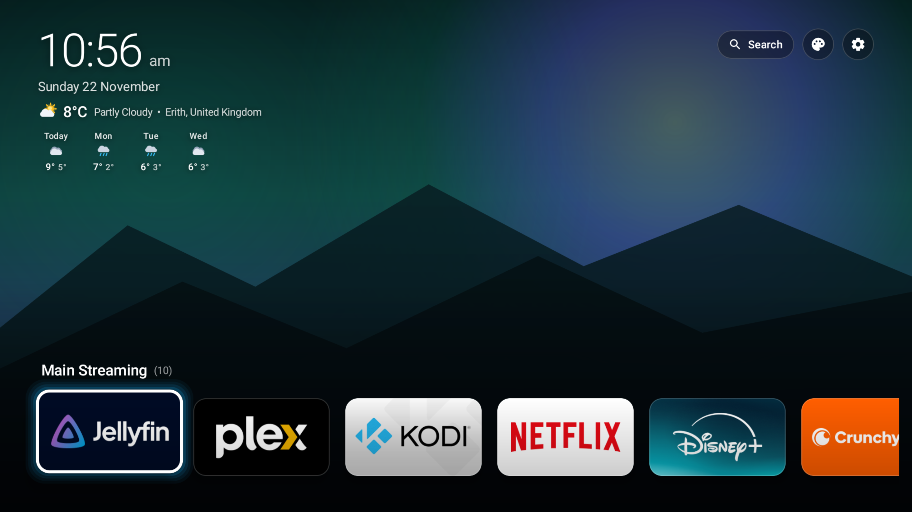
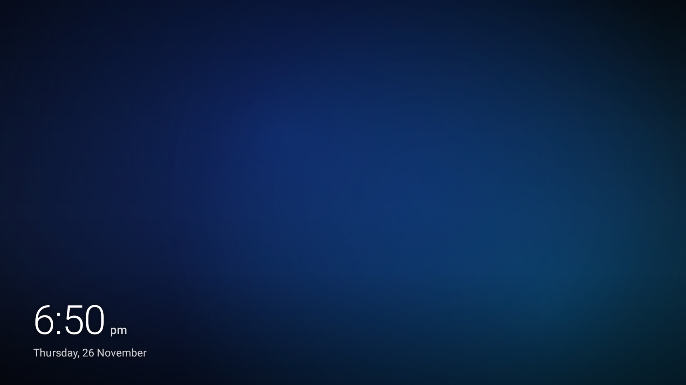

<p align="center">
  
</p>

<h1 align="center">Horizon TV Launcher</h1>

<p align="center">
  A clean, fast, ad-free <strong>Android TV / Nvidia Shield home launcher</strong> built with Jetpack Compose — designed for living-room full-bleed artwork, crisp D-pad navigation, and universal streaming &amp; library search.
</p>

> **Latest Release:** Download [`HorizonTVLauncher-v2.5.17.apk`](https://github.com/darkside281/HorizonTVLauncher/releases/latest) from the [Releases](https://github.com/darkside281/HorizonTVLauncher/releases) page.

---

## Screenshots

### Home Screen & Live Artwork
Full-bleed widescreen wallpapers with ClearLogos, live weather, and customizable artwork-only or titled app rows.



### Universal Search (Where to Watch + Jellyfin + Apps)
Search across UK streaming services (filtered to your subscriptions & Prime Video Channels), your own Jellyfin server with vertical posters, and installed apps — opening movies and TV shows directly to their **Overview / Details** screen.


### Customize Overlay
TV-friendly two-pane settings overlay for rows, search providers, live wallpapers, screensaver, weather, appearance, and backup/restore.


### Full-Screen Idle Screensaver & Android DreamService
Ken Burns widescreen artwork slideshow with optional clock, weather, burn-in shift, and ClearLogos.



---

## What It Can Do

### Home Screen & App Organization
- **Custom Home Rows**: Create, rename, reorder, delete, and lock custom app rows.
- **Flexible Tiles**: Choose **Small / Medium / Large** tile sizes, toggle **App Titles Under Tiles** on/off for a clean artwork-only dock, rename apps, and assign custom PNG/JPG app icons.
- **All Apps Grid & Filtering**: Optional All Apps section with configurable 4–6 column layout, TV/Mobile app filtering, and app hiding/restoring.
- **Resolution-Independent TV Layout**: Scales consistently across 720p, 1080p, and 4K TVs.

### Universal Search & Where to Watch
- **JustWatch UK Integration**: See which streaming services carry any movie or TV show.
- **My Streaming Services & Prime Video Channels**: Filter search results to only the services you subscribe to — including dedicated **Prime Video Channels** (*Paramount+*, *MGM+*, *Crunchyroll*, *Discovery+*, *Shudder*, *MUBI*, *BFI Player*, *Acorn TV*, *Hayu*, *Curzon*, *Studiocanal*, and more) and optional Rent & Buy filtering.
- **Overview Screen Deep-Links**: Selecting a movie or TV show opens the **Title Overview / Details** page instead of immediately auto-playing on Prime Video (and Prime Channels), Netflix, Disney+, Apple TV, ITVX, Paramount+, and Crunchyroll.
- **Jellyfin Library Search**: Live search your Jellyfin server with 2:3 vertical posters and jump straight into Jellyfin TV.
- **Quick App & Web Search**: Search matching installed apps or jump straight to in-app search for installed streaming apps, YouTube/SmartTube, or the web.

### Live Wallpapers (Per-Service Configs)
- Supports **Jellyfin**, **Plex**, **Emby**, **TMDB**, **Reddit** (curated & custom subreddits), **Custom Local Image**, and built-in **Ambient Gradient Themes**.
- **Independent Per-Service Settings**: Each wallpaper provider saves its own **Show Movie/Show Logo** (or **Subreddit Credit**), **Slideshow Speed**, **Wallpaper Count**, and **Media Type** independently.
- **Multi-Select Libraries & Categories** plus adjustable wallpaper dimming.

### Built-In Screensaver & Android System DreamService
- **3 Modes**: Live Wallpaper Artwork, Local Photos / Folder, or Ambient Theme Cycle.
- Supports smooth **Ken Burns** motion, **OLED burn-in shift**, configurable idle timeout & slide interval, and optional Clock / Weather / Title overlays.
- Registers as an Android TV **System Screensaver (`DreamService`)** too.

### Live Weather
- Powered by **Open-Meteo** (no API key required).
- Configurable 1–7 day forecast, Celsius/Fahrenheit, 4 icon styles, compact/expanded sizing, and transparent overlay mode.

### Backup, Restore, Reset & Built-In GitHub Updater
- **GitHub Self-Updater**: Automatically checks GitHub Releases for newer versions on startup (or manually under **Customize → About**), shows release notes, and lets you choose **Update Now** (downloads and installs the APK directly on your TV) or **Not Now**.
- **Portable JSON Backup & Restore** of your full launcher configuration (rows, themes, wallpapers, per-service configs, weather, search filters, and screensaver) for easy transfer across devices.
- **Reset Launcher to Defaults** with two-step confirmation under **Customize → Launcher & Apps**.

For detailed setup instructions, see [USER_GUIDE.md](USER_GUIDE.md).

---

## Installation

1. Download the latest APK (`HorizonTVLauncher-v2.5.16.apk`) from the [Releases](https://github.com/darkside281/HorizonTVLauncher/releases) page.
2. Sideload it onto your Nvidia Shield / Android TV device (via USB, file manager, or ADB):
   ```bash
   adb install -r HorizonTVLauncher-v2.5.16.apk
   ```
3. Open **Horizon TV Launcher** → **Customize → Launcher & Apps → Set as Default Home**.
   - On Nvidia Shield, you can also disable the stock launcher via ADB if desired:
     ```bash
     adb shell pm disable-user --user 0 com.google.android.tvlauncher
     adb shell cmd package set-home-activity com.horizontv.launcher/.MainActivity
     ```

---

## Building From Source

Requires JDK 17 and the Android SDK (API 36).

```bash
git clone https://github.com/darkside281/HorizonTVLauncher.git
cd HorizonTVLauncher
./gradlew assembleDebug
```

The built APK will be generated at `app/build/outputs/apk/debug/app-debug.apk`.

---

## Third-Party APIs, Attribution & Trademarks

- **TMDB:** This product uses the TMDB API but is not endorsed or certified by TMDB. Users supply their own personal TMDB API key.
- **Weather:** Weather and forecast data is provided by [Open-Meteo](https://open-meteo.com/).
- **Media Servers & Feeds:** Jellyfin, Plex, Emby, and Reddit wallpapers are fetched directly from the user's own configured servers or public read-only feeds at runtime; no third-party media artwork is bundled with this application.
- **Trademarks & Disclaimer:** Horizon TV Launcher is an independent, open-source project and is not affiliated with, endorsed by, or sponsored by Google, Android TV, Nvidia, Netflix, Amazon Prime Video, Disney+, Apple TV, Paramount+, Crunchyroll, ITVX, BBC, Channel 4, JustWatch, Jellyfin, Plex, Emby, TMDB, or Reddit. All product names, logos, and brands are the property of their respective owners.

## License

Licensed under the [MIT License](LICENSE).

