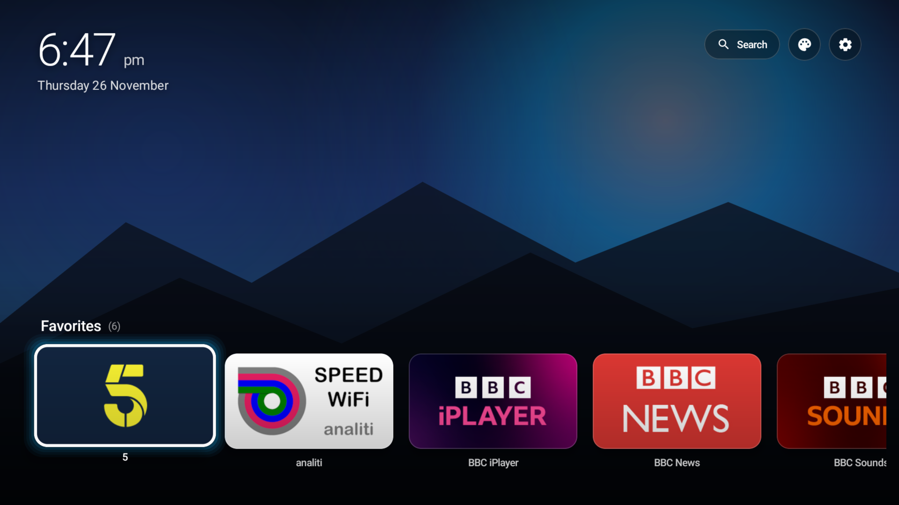
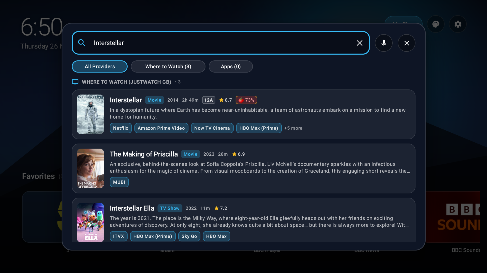
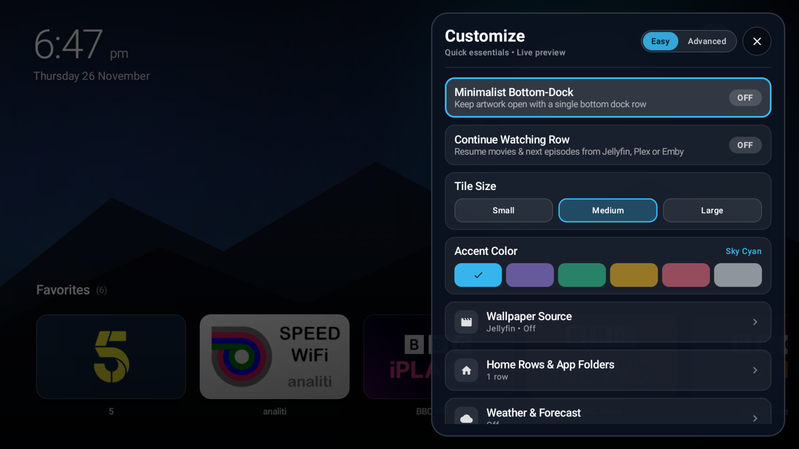
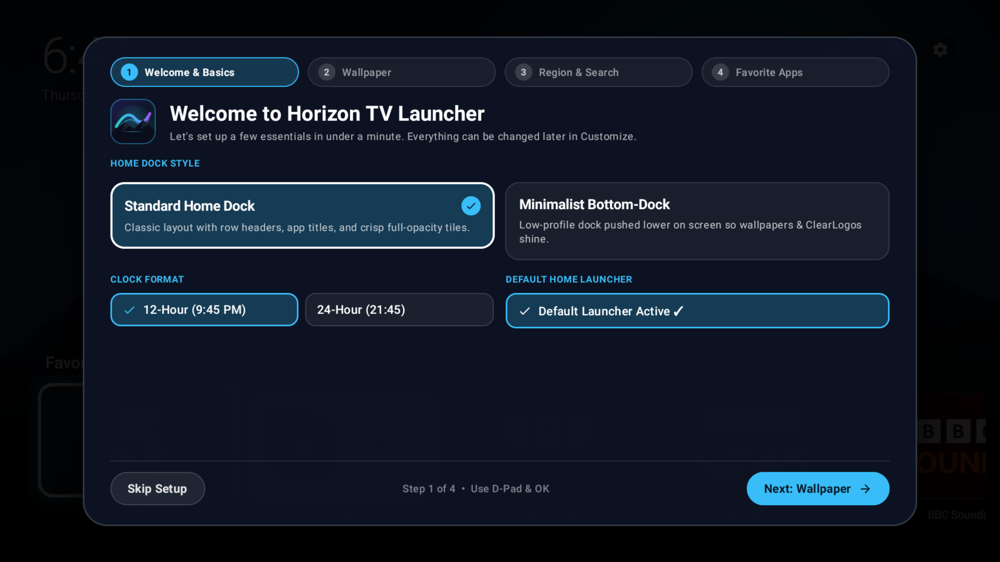

<p align="center">
  
</p>

<h1 align="center">Horizon TV Launcher</h1>

<p align="center">
  A clean, fast, ad-free <strong>Android TV / Nvidia Shield home launcher</strong> built with Jetpack Compose — designed for living-room full-bleed artwork, crisp D-pad navigation, universal streaming &amp; library search, and effortless phone/PC remote editing.
</p>

<p align="center">
  <strong>100% Free &amp; Open Source</strong> &nbsp;·&nbsp; <strong>No Paywalls or Pro Tiers</strong> &nbsp;·&nbsp; <strong>No Ads or Telemetry</strong> &nbsp;·&nbsp; <strong>Zero Extra Permissions</strong> &nbsp;·&nbsp; <strong>~2.3 MB APK</strong>
</p>

---

## Everything Included — Free, Out of the Box

Every feature in Horizon TV Launcher is unlocked from day one with no subscriptions, no license keys, and no tracking:

- **Continue Watching / "Up Next" Row** — One-click resume for in-progress movies and next episodes from your **Jellyfin**, **Plex**, or **Emby** server, with progress bars and remaining time.
- **Custom Wallpapers Everywhere** — Local images, multi-photo folders, **SMB network shares (`smb://...`)**, **Jellyfin / Plex / Emby**, **TMDB**, **Reddit**, **6 Ambient Themes**, and **Ken Burns slow motion**.
- **Unlimited Custom Rows & App Folders** — Organize apps into custom rows, **2×2 preview App Folders**, and **16:9 Banner / 1:1 Square / 2:3 Poster** tile shapes.
- **Full Visual Customization** — Minimalist Bottom-Dock mode, custom **Clock styles & typography**, corner roundness, focus glow styles, tile opacity, and custom PNG/JPG app icons.
- **Universal Media & Voice Search** — Search streaming availability across 8 regions, your own Jellyfin library, and installed apps — with zero-permission system voice search.
- **Phone / PC Local Web Companion** — Scan a QR code to drag-and-drop reorder tiles, batch-upload wallpapers, paste API keys, and configure every setting from your browser.
- **Built-In Screensaver & Live Weather** — Android System `DreamService` with OLED burn-in shift and Open-Meteo 7-day forecasts (no API key required).
- **Parental PIN Lock & Portable Backup/Restore** — Lock settings or individual apps behind a 4-digit PIN, and export/import your entire setup as JSON.

---

## Screenshots

### Home Screen & Live Artwork
Full-bleed widescreen wallpapers with ClearLogos, live weather, and customizable artwork-only, titled, or Minimalist Bottom-Dock app rows.



### Universal Search (Where to Watch + Jellyfin + Apps + Voice)
Search across streaming services (filtered to your region, subscriptions & Prime Video Channels), your own Jellyfin server with vertical posters, and installed apps — with full Title Details popups and direct **Overview / Details** deep-links.



### Customize Drawer (Easy / Advanced + Live Preview)
Translucent right-side settings drawer that keeps your real TV Home screen live and visible on the left — switch between **Easy Mode** (everyday essentials) and **Advanced Mode** (every power-user section) with a single pill.



### 4-Step First-Run Setup Wizard
Guided setup for dock style, clock format, wallpapers, search region, and favorite apps right out of the box.



### Full-Screen Idle Screensaver & Android DreamService
Ken Burns widescreen artwork slideshow with optional clock, weather, burn-in shift, and ClearLogos.


---

## What It Can Do

### Home Screen & Layout
- **Continue Watching / "Up Next" Row (Jellyfin, Plex & Emby)**: Optional row (under **Customize → Home → Rows**) that reuses your existing media server connection to display in-progress movies and next episodes with 16:9 resume cards, episode/movie badges, time-remaining pills, progress bars, and one-click resume.
- **Custom Home Rows, App Folders & Per-Row Tile Shapes**: Create, rename, reorder, delete, sort A–Z, and lock custom app rows — group related apps into **App Folders (2×2 preview tiles)** with frosted popup grids, and switch any individual row between **16:9 Banner**, **1:1 Square**, or **2:3 Poster** tiles.
- **Minimalist Bottom-Dock Mode**: Clean frosted bottom dock that keeps your wallpaper artwork front and center.
- **Flexible Tile Styling**: Choose **Small / Medium / Large** tile sizes, **Compact / Normal / Wide** tile spacing, **40%–100%** unfocused tile opacity, **Sharp / Rounded / Soft** corner roundness, **Accent Glow / Crisp Outline / Zoom Only / Soft Shadow** focus styles, toggle **App Titles Under Tiles**, rename apps, and assign custom PNG/JPG app icons.
- **Custom Clock Styles & Typography**: Choose **Classic**, **Centered Cinema**, **Analog Dial**, or **Minimal** clock layouts with selectable **Modern Sans / Editorial Serif / Tech Mono** fonts and **Light / Regular / Bold** weights.
- **TV Inputs (HDMI) Switcher**: Automatically detects hardware HDMI, AV, Component, DisplayPort, and Tuner inputs on Android TV / Google TV smart TVs with an on-screen top-bar switcher (auto-hidden on streaming boxes without hardware inputs).
- **All Apps Grid & Filtering**: Optional All Apps section with configurable 4–6 column layout, TV/Mobile app filtering, and app hiding/restoring.
- **Resolution-Independent TV Layout**: Scales consistently across 720p, 1080p, and 4K TVs.

### Universal Search, Voice Search & Where to Watch
- **Multi-Region JustWatch Integration**: See which streaming services carry any movie or TV show across **8 supported regions** (`GB`, `US`, `CA`, `AU`, `IE`, `DE`, `FR`, `NL`).
- **Zero-Permission Voice Search**: Tap the microphone button to speak your search query using Android's system speech recognizer (no `RECORD_AUDIO` permission required).
- **Full Title Details Popup & Recent Searches**: Click any movie or TV show to inspect its full synopsis, runtime, genres, IMDb & Rotten Tomatoes scores, age rating, directors, cast, and all streaming options — plus quick-pick **Recent Searches**.
- **My Streaming Services & Prime Video Channels**: Filter search results to only the services you subscribe to — including dedicated **Prime Video Channels** (*Paramount+*, *ITVX via Prime*, *MGM+*, *Crunchyroll*, *Discovery+*, *Shudder*, *MUBI*, *BFI Player*, *Acorn TV*, *Hayu*, *Curzon*, *Studiocanal*, and more) and optional Rent & Buy filtering.
- **Overview Screen Deep-Links**: Selecting a movie or TV show opens the **Title Overview / Details** page instead of immediately auto-playing on Prime Video (and Prime Channels), Netflix, Disney+, Apple TV, ITVX, Paramount+, and Crunchyroll.
- **Jellyfin Library Search**: Live search your Jellyfin server with 2:3 vertical posters and jump straight into Jellyfin TV.
- **Quick App & Web Search**: Search matching installed apps or jump straight to in-app search for installed streaming apps, YouTube/SmartTube, or the web.

### Local Web Companion (Phone / PC Browser)
- **QR Code Wi-Fi Remote Editor**: Start a temporary local HTTP server from **Customize → Launcher & Apps → Local Web Companion (Phone / PC)…** protected by a fresh 4-digit session code (auto-filled when scanning the QR code).
- **Full 6-Tab Browser Control Center**:
  - **Home & Dock**: Drag-and-drop reorder tiles (mouse & mobile touch) with real TV app icons and friendly names, add any installed Android app, sort A–Z, clean up uninstalled backup apps, and manage rows, folders, clock & tile styles.
  - **Search & Services**: Configure your JustWatch region, subscribed streaming services, Prime Video Channels, and search preferences.
  - **Wallpapers & Apps**: Switch Ambient Themes & Accent colors live, configure Live Slideshow Wallpapers, batch-upload photos to your Local Album, upload custom Home wallpapers, and upload custom app icons.
  - **Screensaver & Weather**: Search and set your Weather location from your phone/PC keyboard and adjust all Weather & Screensaver settings.
  - **Servers & API Keys**: Paste Jellyfin, Plex, Emby, SMB share, and TMDB URLs and credentials directly from your clipboard.
  - **Security & Backup**: Manage Parental Controls PINs and download or upload/restore your full Horizon JSON backup right from the browser.

### Live Wallpapers (Per-Service Configs)
- Supports **Jellyfin**, **Plex**, **Emby**, **TMDB**, **Reddit** (curated family-friendly categories & custom feeds), **Local Folder & Web-Uploaded Photo Album**, **SMB Network Shares (`smb://...`)**, **Single Custom Image**, and **6 built-in Ambient Gradient Themes**.
- **Independent Per-Service Settings**: Each wallpaper provider saves its own **Show Movie/Show Logo**, **Slideshow Speed**, **Wallpaper Count**, and **Media Type** independently.
- **Multi-Select Libraries & Categories**, adjustable wallpaper dimming, and optional **Ken Burns Slow Motion** pan/zoom on your Home wallpaper (works with both live slideshows and custom static wallpapers).

### Built-In Screensaver & Android System DreamService
- **3 Modes**: Live Wallpaper Artwork, Local Photos / Folder, or Ambient Theme Cycle.
- Supports smooth **Ken Burns** motion, **OLED burn-in shift**, configurable idle timeout & slide interval, and optional Clock / Weather / Title overlays.
- Registers as an Android TV **System Screensaver (`DreamService`)** too.

### Live Weather
- Powered by **Open-Meteo** (no API key required).
- Configurable 1–7 day forecast, Celsius/Fahrenheit, 4 icon styles, Small/Medium/Large sizing, and transparent overlay mode.

### Parental Controls, Setup Wizard, Backup & GitHub Updater
- **Parental Controls (4-Digit PIN)**: Lock **Customize** settings and/or individual apps behind a 4-digit PIN (with lock badges on tiles).
- **4-Step First-Run Setup Wizard**: Guided setup on fresh installs (re-runnable anytime from **Customize → Launcher & Apps**).
- **GitHub Self-Updater**: Configurable **Automatic / Every 7 Days / Manual** update checks under **Customize → Updates**, with release notes and one-click in-app download & install.
- **Portable JSON Backup & Restore** of your full launcher configuration (rows, themes, wallpapers, per-service configs, weather, search filters, parental PINs, and screensaver) plus two-step **Reset to Defaults**.

For detailed setup instructions, see [USER_GUIDE.md](USER_GUIDE.md).

---

## Compatible Devices

Horizon TV Launcher targets **Android 7.0+ (API 24)** up to **Android 16**, requires **no Google Play Services**, scales cleanly across **720p, 1080p, and 4K**, and ships as a single universal APK (**ARM64, ARM32, and x86_64**).

- **Nvidia Shield TV** (2015, 2017, 2019, Pro) — *tested & verified*
- **Google TV devices** (Chromecast with Google TV, Google TV Streamer, Onn 4K / 4K Pro)
- **Android TV boxes & sticks** (Xiaomi Mi Box / TV Stick, Mecool, Homatics, generic Android TV boxes)
- **Smart TVs with Android TV / Google TV** (Sony Bravia, TCL, Hisense, Philips)
- **Waydroid** (Linux x86_64 / ARM64) — *tested & verified*
- **Amazon Fire TV (Fire OS 7+)** — app runs, though newer Fire OS versions restrict replacing the Home button

> **Notes:**
> - **Where to Watch (JustWatch)** supports `GB`, `US`, `CA`, `AU`, `IE`, `DE`, `FR`, and `NL` (configurable under **Customize → Search → General**); all other features work worldwide.
> - Devices without a built-in system file picker (some Google TV sticks) can upload wallpapers/icons and import/export backups via the **Local Web Companion** or via ADB (see [USER_GUIDE.md](USER_GUIDE.md)).

---

## Installation

1. Download the latest APK (`HorizonTVLauncher-v2.5.59.apk`, ~2.4 MB R8-optimized) from the [Releases](https://github.com/darkside281/HorizonTVLauncher/releases) page.
2. Sideload it onto your Android TV / Google TV device (via USB, file manager, or ADB):
   ```bash
   adb install -r HorizonTVLauncher-v2.5.59.apk
   ```
3. Open **Horizon TV Launcher** (follow the 4-step Setup Wizard, or open **Customize → Launcher & Apps → Set as Default Home**).
   - **Android TV (Nvidia Shield, Sony, etc.)** — optionally disable the stock launcher via ADB so the Home button always opens Horizon:
     ```bash
     adb shell pm disable-user --user 0 com.google.android.tvlauncher
     adb shell cmd package set-home-activity com.horizontv.launcher/.MainActivity
     ```
   - **Google TV (Chromecast, Onn, Google TV Streamer, etc.)** — disable the Google TV launcher package instead:
     ```bash
     adb shell pm disable-user --user 0 com.google.android.apps.tv.launcherx
     adb shell cmd package set-home-activity com.horizontv.launcher/.MainActivity
     ```

---

## Building From Source

Requires JDK 17 and the Android SDK (API 36).

```bash
git clone https://github.com/darkside281/HorizonTVLauncher.git
cd HorizonTVLauncher
./gradlew assembleDebug
```

The built APK will be generated at `app/build/outputs/apk/debug/app-debug.apk`.

---

## Third-Party APIs, Attribution & Trademarks

- **TMDB:** This product uses the TMDB API but is not endorsed or certified by TMDB. Users supply their own personal TMDB API key.
- **Weather:** Weather and forecast data is provided by [Open-Meteo](https://open-meteo.com/).
- **Media Servers & Feeds:** Jellyfin, Plex, Emby, and Reddit wallpapers are fetched directly from the user's own configured servers or public read-only feeds at runtime; no third-party media artwork is bundled with this application.
- **Trademarks & Disclaimer:** Horizon TV Launcher is an independent, open-source project and is not affiliated with, endorsed by, or sponsored by Google, Android TV, Nvidia, Netflix, Amazon Prime Video, Disney+, Apple TV, Paramount+, Crunchyroll, ITVX, BBC, Channel 4, JustWatch, Jellyfin, Plex, Emby, TMDB, or Reddit. All product names, logos, and brands are the property of their respective owners.

## License

Licensed under the [MIT License](LICENSE).
